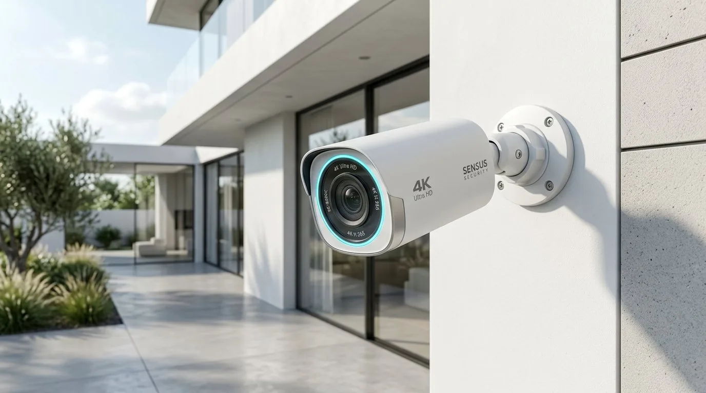

# MZ Smart CCTV – Sleek 4K Security & Installation

A modern, responsive, high-performance web application for a premier CCTV installation and smart security systems provider.



## ✨ Key Features

- **Sleek Frosted Glassmorphism UI:** Clean white glass cards, high-contrast typography, and fluid micro-interactions.
- **Interactive 4K Camera POV Mode:** Real-time surveillance HUD simulator with live timestamp, 4 switchable camera sensor modes (Daylight 4K, Color Night Vision, AI Human/Vehicle Tracking, and 360° PTZ Panoramic).
- **Interactive Security Cost Calculator:** Real-time quote estimator calculating equipment, DVR/NVR storage, wiring, and installation costs based on property type, camera count, and resolution.
- **Instant WhatsApp Dispatch:** Quote builder automatically validates, sanitizes, and transfers all project specifications into a pre-formatted WhatsApp consultation message.
- **Comprehensive Mobile Optimization:** Fluid responsive layout preventing horizontal wobble across viewports from 320px up to 4K displays (optimized for iPhone 16 viewport 393px).
- **Vercel Web Analytics & Speed Insights:** Integrated telemetry and Core Web Vitals monitoring.
- **Next-Gen WebP Imagery:** 100% WebP image assets achieving an 81.5% payload reduction (~1.4 MB total bundle) for lightning-fast First Contentful Paint.

## 🚀 Tech Stack

- **HTML5:** Semantic architecture, accessible forms, meta tags for social & WhatsApp previews.
- **CSS3:** Custom properties design system, CSS grid/flexbox, frosted glass blur (`backdrop-filter`), responsive media queries.
- **JavaScript (ES6+):** Throttled single `requestAnimationFrame` scroll handling, secure form sanitization, dynamic quote calculator, tabbed camera HUD viewer.
- **Vercel:** Optimized static deployment with `vercel.json` edge caching, clean URLs, and security headers.

## 📦 Local Development

To run locally:

```bash
# Clone the repository
git clone https://github.com/whosatif/cctv-website.git
cd cctv-website

# Install optional analytics dependencies
npm install

# Run with any static HTTP server, for example:
npx serve .
# or
python -m http.server 8080
```

Open `http://localhost:8080` in your web browser.

## 🌐 Deploy on Vercel

1. Push this repository to GitHub.
2. In Vercel, click **Add New...** > **Project**.
3. Import `cctv-website` from your GitHub account.
4. Click **Deploy**.
5. In the Vercel project dashboard, go to the **Analytics** tab and click **Enable**.

## 📄 License

MIT License. Designed & Developed for MZ Smart Security Systems.
